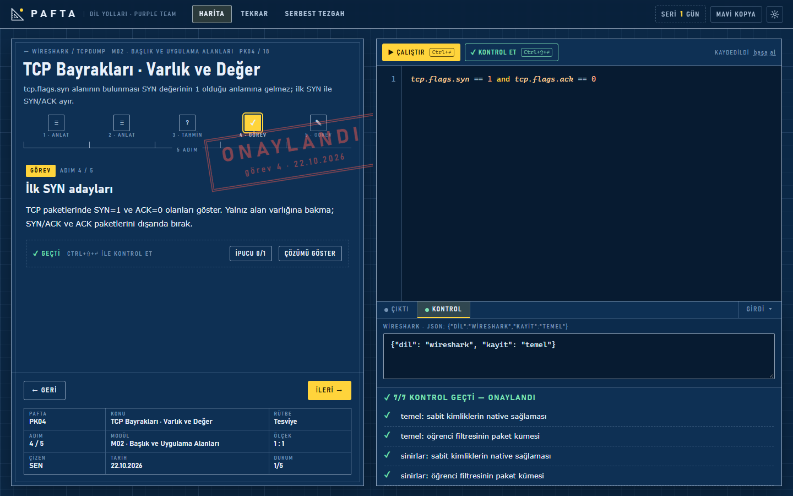
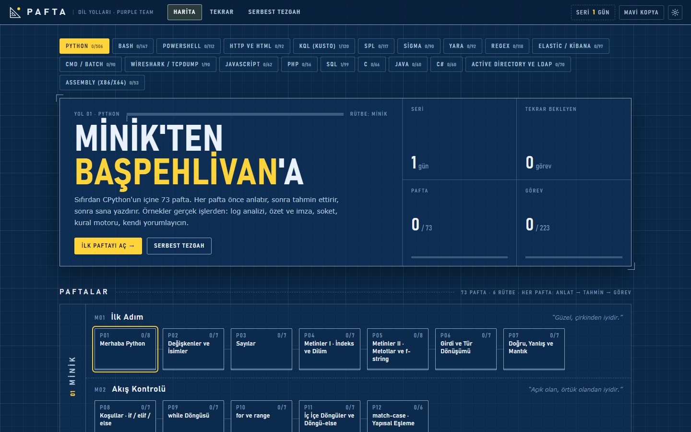
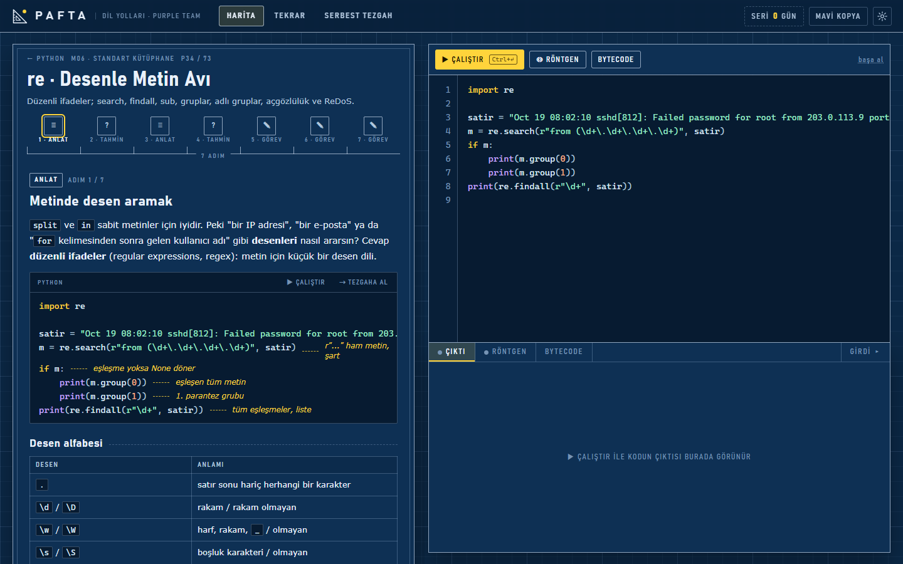
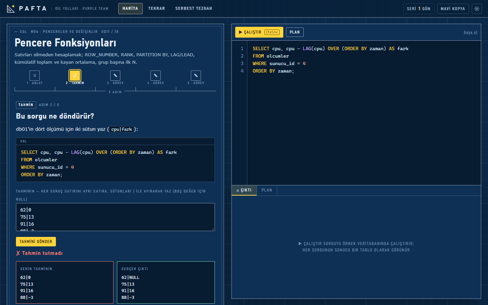
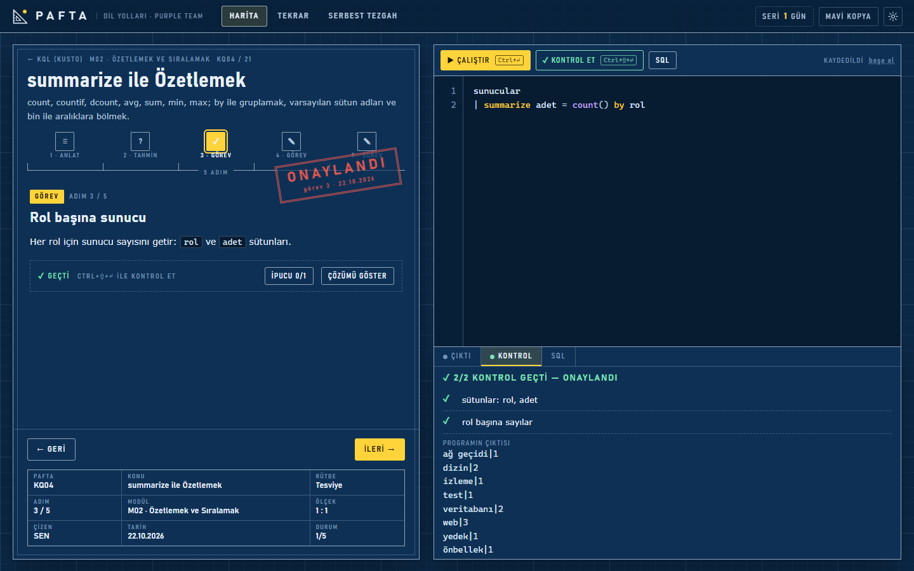

# Pafta

**Yerel çalışan, tek kişilik bir dil okulu.** Yirmi dil ve sorgu dili için 393 pafta (ders); her pafta önce anlatır, sonra tahmin ettirir, sonra sana yazdırır. Yazdıkların gerçek araçlarda çalışır: TShark, libpcap, libyara, pySigma, Apache Lucene, SQLite, Windows PowerShell, cmd.exe, Node.js.



---

## Neden farklı

Çoğu alıştırma sitesi soruyu sorar, cevabı gösterir. Pafta araya iki adım koyar.

| Adım | Ne olur | Neden |
|---|---|---|
| **Anlat** | Konu, ölçü notlu kod örnekleriyle anlatılır. Örnekleri oracıkta çalıştırabilir, tezgaha alıp kurcalayabilirsin. | Önce ne olduğunu bilmeden yazmak ezber üretir. |
| **Tahmin** | Kodu görürsün, çıktısını **yazarsın**, sonra gerçek çıktıyla karşılaştırılır. | Yanlış bir zihin modelini ancak yanıldığını görünce fark edersin. |
| **Görev** | Kodu sen yazarsın; gizli testler sınır değerleriyle, boş ve bozuk girdiyle dener. | Çalışan kod ile doğru kod aynı şey değildir. |

Aşağıdaki [tahmin ekranı](#ekranlar) bunun tam örneği: öğrenci `LAG`'in ilk satırda `0` döndüreceğini sanıyor, gerçek cevap `NULL`. O farkı bir daha unutmazsın.

**Gerçek araç, gerçek çıktı.** Wireshark yolunda filtre gerçek TShark'a, BPF gerçek libpcap'e gider. YARA kuralını gerçek libyara derler. Sigma kuralını resmi pySigma ayrıştırır. Lucene sorgusu gerçek Apache Lucene'de çalışır. Taklit motor yazılan yerlerde (KQL, SPL, Elastic EQL, LDAP) sınırlar açıkça yazılır ve desteklenmeyen özellik sessizce yanlış cevap vermek yerine hata verir.

**Geçtiğin görev unutulmaz.** Her geçilen görev tekrar kutusuna düşer ve 1, 3, 7, 16, 35 gün sonra boş sayfadan yeniden sorulur.

---

## Yollar

393 pafta · 2197 adım · 465 tahmin · 1047 görev. Her yol altı rütbeye bölünür: Minik → Tesviye → Küçük Orta → Büyük Orta → Başaltı → Başpehlivan.

### Her iki taraf

| Yol | Pafta | Ne öğretir |
|---|---|---|
| Python | 73 | Sıfırdan CPython'un içine: koleksiyonlar, nesne yönelimi, üreteç ve dekoratör, asyncio, metasınıf ve bytecode, dört proje |
| Bash | 28 | Quoting ve genişleme, awk, sed, find/xargs, süreç ve sinyaller, getopts ile araç yazmak |
| PowerShell | 21 | Boru hattı ve nesneler, gelişmiş fonksiyonlar, sınıflar, sağlayıcılar, CIM, Windows olay günlükleri ve Sysmon telemetrisi |
| HTTP ve HTML | 15 | Ham istek ve yanıt, kodlama, durum ve başlıklar, çerez ve kimlik, formlar; kendi istemcini yazmak |
| CMD / Batch | 18 | Parametreler, değişken açılımı, `for /f`, hata kodları, alt yordamlar |

### Savunma tarafı

| Yol | Pafta | Ne öğretir |
|---|---|---|
| SQL | 18 | JOIN, pencere fonksiyonları ve çerçeveler, boşluk-ada, oturumlar, özyineleme, görünümler |
| KQL (Kusto) | 21 | Sentinel sorguları: `summarize`, `join`, `parse`, dinamik veri, `arg_max`, sıralı satırlar, IP aralıkları |
| SPL | 20 | Splunk arama dili: `timechart`, `eventstats`, `lookup`, `transaction`, bilgi nesneleri ve CIM |
| Elastic / Kibana | 19 | Kibana KQL, Lucene query string ve Elastic EQL; mapping, analyzer, olay dizileri |
| Sigma | 18 | Seçimler ve modifier'lar, veri kalitesi, yanlış pozitifler, korelasyon okuma |
| YARA | 18 | Metin ve hex kuralları, regex, sayım ve konum, `pe`/`hash`/`math` modülleri |
| Wireshark / tcpdump | 18 | Görüntü filtreleri ve BPF; alanlar, bayraklar, uzunluk koşulları, fragment ve VLAN |
| Regex | 22 | Temelden bakınma ve atomik gruplara; Unicode, Türkçe İ/ı tuzağı, lehçe farkları |
| Active Directory ve LDAP | 12 | DN/OU ağacı, RFC 4515 filtreleri, `userAccountControl` bit eşleşmesi, `Get-AD*` komutları |

### Okuyabilecek kadar

Bu yollar bilerek **okuma düzeyindedir**: kodu yazman değil, başkasının kodunu doğru okuman hedeflenir. Tahmin adımları okunan dildedir; görevlerde aynı davranışı Python'da kurarsın.

| Yol | Pafta | Ne öğretir |
|---|---|---|
| JavaScript | 12 | Kapsam ve `this`, sınıflar ve prototipler, asenkron kod, Node sunucu kodu, küçültülmüş kod |
| C | 13 | İşaretçiler, tamsayı taşması, yapı düzeni ve hizalama, bayt tamponları, önişlemci, Windows API |
| Java | 12 | İlkel türler, String havuzu, koleksiyonlar, Stream, Servlet filtreleri, JDBC, yansıma |
| C# (.NET) | 12 | Değer/referans türleri, null güvenliği, LINQ ve ertelenmiş çalıştırma, `async`/`await`, EF Core |
| PHP | 11 | Metinler ve baytlar, gevşek türler, sınıflar ve trait'ler, PDO, oturumlar ve parolalar |
| Assembly (x86/x64) | 12 | Yazmaçlar, bellek ve endian, bayraklar ve dallanma, yığın ve çağrı kuralları, `objdump` okuma |

---

## Kurulum

> **Pafta yalnızca Windows'ta çalışır.** Windows PowerShell 5.1, `cmd.exe` ve Windows olay günlükleri gibi Windows'a özgü bileşenlere doğrudan bağlıdır; Linux ve macOS'ta desteklenmez.

**1. Python 3.11 veya üstünü kur.** Kurulumda "Add Python to PATH" seçeneğini işaretle.

**2. Depoyu indir ve klasöre gir.**

```text
git clone <depo-adresi> Pafta
cd Pafta
```

**3. Başlat.**

```text
pythonw Pafta.pyw
```

Uygulama yerel bir sunucu açar ve Microsoft Edge'i uygulama penceresi kipinde başlatır (Edge yoksa varsayılan tarayıcı açılır). Pencereyi kapatınca sunucu kendini kapatır. Geliştirme için:

```text
python server.py --port 8765
```

İlerlemen `%LOCALAPPDATA%\Pafta\progress.json` dosyasında tutulur; proje klasörünü taşısan da kaybolmaz.

### Hangi yol neyi ister

Yolların çoğu ek kurulum istemez. İstediğin yolu açmadan önce yalnızca o satırı kur: eksik araç, sessizce yanlış sonuç yerine açık bir hata verir.

| Yol | Gereken | Nasıl |
|---|---|---|
| Python, SQL, KQL, SPL, HTTP ve HTML, Regex, AD/LDAP, okuma yolları (C, PHP, Java, C#, Assembly) | Yalnızca Python 3.11+ | Ek kurulum yok |
| PowerShell, CMD / Batch | Windows PowerShell 5.1 ve `cmd.exe` | Windows'la birlikte gelir |
| Bash | Git for Windows (Git Bash) | [git-scm.com](https://git-scm.com/download/win) |
| JavaScript | Node.js | [nodejs.org](https://nodejs.org/) |
| Sigma, YARA | pySigma ve yara-python | `python -m pip install --target .deps -r requirements-detection.txt` |
| Wireshark / tcpdump | TShark + libpcap paketi | Wireshark'ı kur, sonra `python -m pip install --target .deps -r requirements-packets.txt` |
| Elastic / Kibana | JDK 17+ ve pinli Lucene JAR'ları | `python tools/install_elastic_runtime.py` |

Paketler proje içindeki `.deps` klasörüne kurulur; sistem Python'unu ve başka projeleri değiştirmez. `.deps` depoya girmez.

---

## Ekranlar

**Harita.** Yollar, rütbeler ve modüller; her paftanın kaç adımını bitirdiğin.



**Anlat.** Konu, ölçü notlu kod ve sağda tezgah: çalıştır, Röntgen ile adım adım izle, Bytecode'a bak.



**Tahmin.** Çıktıyı sen yazarsın; gerçek çıktı yan yana gösterilir.



**Görev.** Kodu sen yazarsın, testler denetler; geçince mühür basılır.



---

## Kalite

Her görevin gizli testleri vardır ve bu testler yalnızca doğru cevabı değil, sınırları da dener: eşiğin altı, tam eşiği ve üstü, boş girdi, bozuk girdi, eksik alan. Bir doğrulayıcı bütün yolları baştan sona koşar ve her görevde örnek çözümün geçtiğini, başlangıç kodunun geçmediğini, anlatım ve tahmin kodlarının hatasız çalıştığını denetler; bugün 393 paftada 3388 kontrol temiz geçiyor. Tahmin adımlarının açıklamaları gerçek çalıştırma çıktısıyla karşılaştırılır, uydurma cevap kalmaz. Taklit motorların (KQL, SPL, EQL, LDAP) gerçek üründen ayrıldığı yerler derslerde açıkça yazılır.

---

## Sınav kipi ve kazanım haritası

Her yolun haritasında bir **kazanım** bölümü var: sertifikanın resmî konu listesi, her bölüm sınavdaki ağırlığı kadar geniş çizilir ve her maddenin altında onu karşılayan paftalar görünür. Hiçbir pafta karşılamıyorsa madde "çizilmedi" diye işaretlenir. Dokuz yol on iki sertifikanın konu listesine eşlendi: PCEP, PCAP, PCPP1, LPIC-1 (kabuk konuları), Oracle 1Z0-071, Splunk Power User ve Advanced Power User, SC-200 KQL yolu, AZ-040, JSA, CLA, Zend PHP.

**Sınav kipi** bu listeye göre süreli bir deneme kurar: bir yolun tamamı, bir sertifika ya da tek bir bölüm. Sorular paftaların tahmin ve görev adımlarından, sertifika kapsamında bölüm ağırlıklarına göre seçilir. Sınav boyunca ipucu, kontrol ve çözüm kapalıdır; süre bitince kendiliğinden puanlanır. Sonuç ekranı bölüm bölüm dökümü, soru soru cevabını ve gerçek sonucu gösterir, yanlış yaptığın görevleri tekrar kutusuna atar.

> **Sınav kipi kendini ölçmek içindir.** Gözetimli bir sertifika sınavının yerine geçmez, resmî bir puan vermez ve hiçbir sertifikayı garanti etmez. Uygulama senin bilgisayarında çalışır; ders çözümleri sınav sırasında da erişilebilir durumdadır. Ölçtüğü tek şey, kendi dürüstlüğünle oturduğun bir denemede ne yaptığındır.

---

## In English

Pafta is a single-user, locally hosted language school for programming, query and detection languages. It covers 20 tracks and 393 lessons, each built as the same three steps: it explains the concept, asks you to predict the output of a real program, then makes you write the code yourself against hidden tests that probe boundaries, empty input and malformed input.

What you write runs in real tooling rather than a simulation: display filters go to TShark, BPF to libpcap, YARA rules to libyara, Sigma rules to the official pySigma parser, Lucene queries to Apache Lucene, SQL to SQLite. Where a subset engine was written instead (KQL, SPL, Elastic EQL, LDAP), its limits are documented and unsupported syntax fails loudly instead of answering wrongly.

Nine tracks are mapped to the published objectives of twelve certifications, and a timed practice-exam mode draws questions from the lessons by section weight. That mode is for self-assessment only: it is not a proctored exam and grants no certification. The app runs on Windows only and keeps all progress on your own machine.

---

## Lisans

**Karar bekliyor.** Bu depo için henüz bir lisans seçilmedi. Lisans dosyası eklenene kadar bütün hakları saklıdır: kodu ve ders metinlerini kopyalamak, dağıtmak ya da türev çalışma üretmek için izin verilmiş sayılmaz. Lisans kararı verildiğinde bu bölüm güncellenecek.
